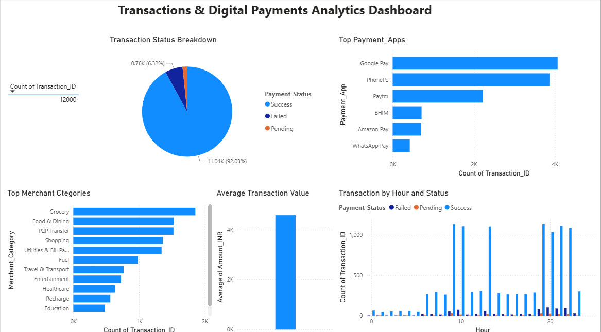

# UPI Transactions Analytics

## Objective
Study how people pay with UPI: which apps, cities and categories are used most, and how often payments fail.

## Dataset
A synthetic (practice) dataset of 12,000 UPI transactions from Jul 2025 to Jun 2026, worth about ₹5.5 crore in total.

## Tools Used
SQL Server (SSMS), Python (Pandas, Kaggle Notebooks), Power BI (DAX)

## Approach
1. SQL: wrote queries on payment apps, categories, cities and payment status.
2. Python: cleaned the data and explored it with EDA.
3. Power BI: built a dashboard to compare apps, categories and time of day.

## Key Findings
- Success rate: 92%, with 6.3% failed and 1.7% pending
- Average transaction: about ₹4,571
- Google Pay (34%) and PhonePe (32%) lead, followed by Paytm (19%)
- 87% of payments are to merchants (P2M), 13% are person to person
- Top categories: Grocery, Food & Dining, P2P Transfer and Shopping
- Top cities: Mumbai, Kolkata and Hyderabad
- Busiest hours: 7 PM, 9 PM and 9 AM
- Failed or pending rates are similar for all apps (about 7–9%), so failures are not caused by one app

## Dashboard

## Recommendations
- Check the payment system itself, since failures are about the same across apps.
- Plan for server load at peak hours (9 AM, 7 PM, 9 PM).
- Focus merchant offers on Grocery and Food & Dining.

## Files
- `upi transactions.sql`: SQL queries (SSMS)
- `upi-transactions-analysis.ipynb`: Python EDA notebook
- `UPI Transactions.pbix`: Power BI dashboard
- `UPI Transactions Dataset.csv`: dataset
